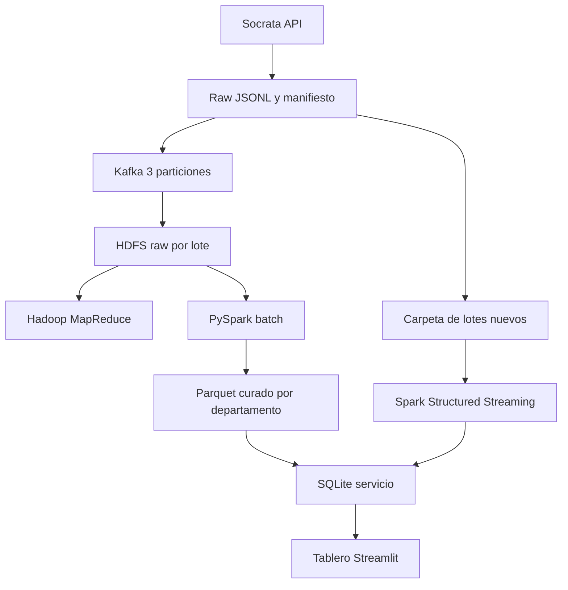

# Contratos SECOP: pipeline de la fuente al tablero

**Pregunta:** ¿Cómo se distribuyen, por departamento, modalidad y fecha de firma, los contratos de la muestra SECOP obtenida mediante la API de datos.gov.co? Los indicadores pueden apoyar a estudiantes y analistas de contratación pública. La muestra actual contiene 20.000 contratos con firmas entre el 1 y el 7 de enero de 2026; no representa todo SECOP ni todos los contratos de 2026.

**Fuente:** [API Socrata jbjy-vk9h](https://www.datos.gov.co/resource/jbjy-vk9h.json). `id_registro` es `id_contrato`. La fecha de ingesta de los dos lotes incluidos es 20 de noviembre de 2026. Los manifiestos indican 1.000 + 19.000 registros, con SHA-256 comprobado. El archivo original no se modifica.

## Arquitectura Lambda



La capa batch limpia, deduplica, contrasta MapReduce con Spark y materializa indicadores exactos de esta carga. La capa rápida procesa lotes nuevos por ventanas de **fecha de ingesta** con watermark y checkpoint; almacena su indicador horario en otra tabla de SQLite. El tablero muestra ambos resultados identificados. Esta separación es Lambda: el contador rápido no se suma al batch, porque contar los mismos contratos dos veces produciría duplicados.

## Preparación en Windows

1. Instala Docker Desktop y Python; abre esta carpeta en VS Code. Conserva el contenedor `kafka-secop` ya creado y el tópico `secop-contratos-raw` de tres particiones. Si no existen, créalos:

   ```powershell
   docker run -d --name kafka-secop -p 9092:9092 apache/kafka:4.4.0
   docker exec kafka-secop /opt/kafka/bin/kafka-topics.sh --create --if-not-exists --topic secop-contratos-raw --bootstrap-server localhost:9092 --partitions 3 --replication-factor 1
   ```

   Si el contenedor existe detenido, usa `docker start kafka-secop`. Comprueba `docker ps` antes de publicar. **No ejecutes de nuevo `productor_secop.py`**: ese script original reenvía todo. Usa el productor incremental incluido aquí.

2. Instala dependencias de la parte que corre en Windows:

   ```powershell
   py -m pip install -r requirements.txt
   ```

3. Ejecuta de principio a fin:

   ```powershell
   .\ejecutar_pipeline.ps1
   ```

   Si PowerShell impide ejecutar el archivo, en esa terminal usa `powershell -ExecutionPolicy Bypass -File .\ejecutar_pipeline.ps1`. Docker descarga imágenes grandes de Hadoop y Spark en la primera ejecución. Para un equipo de 16 GB, asigna a Docker Desktop al menos 8 GB libres. El entorno usa HDFS con un NameNode y un DataNode, Spark local con dos núcleos y SQLite en el host.

4. Comprueba la doble ejecución, conservando la evidencia:

   ```powershell
   .\verificar_idempotencia.ps1
   ```

   En los dos lotes entregados, antes y después deben conservarse 20.000 registros batch y 20.000 en el agregado streaming. El productor nuevo reportará 0 mensajes nuevos cuando los IDs ya existan. El informe `evidencias/idempotencia.txt` registra las cifras observadas. No borres `data/checkpoints/` para una prueba de reinicio.

5. Abre el tablero:

   ```powershell
   py -m streamlit run tablero.py
   ```

   Normalmente aparece en `http://localhost:8501`. Lee únicamente tablas ya calculadas de `data/service.db`.

## Fases y decisiones

| Fase | Archivo o salida | Decisión verificable |
|---|---|---|
| API | `pipeline/ingestar_api.py` | Paginación por cursor compuesto `(fecha_de_firma, id_contrato)`, reintentos HTTP, sobre JSON sin alterar `payload`, manifiesto y marca de agua. |
| Raw | `data/raw/fecha_ingesta=.../` | Un JSON por línea, dos lotes y dos manifiestos. |
| Kafka | `pipeline/publicar_incremental.py` | Clave = ID; antes de publicar compara las claves ya presentes en el tópico. También habilita entrega idempotente del cliente. |
| HDFS | `pipeline/kafka_a_hdfs.py` | Consume Kafka y agrupa por `run_id`; escribe un archivo por lote y fecha, con sobreescritura controlada. |
| MapReduce | `pipeline/mapper.py`, `reducer.py`, `mapreduce.py` | Cuenta contratos por departamento con Hadoop Streaming y el Python 2 incluido en la imagen Hadoop; guarda TSV y compara con Spark sobre raw. |
| Curada | `pipeline/spark_curar.py` | Descarta claves, fechas y valores inválidos; conserva los ceros; mantiene el registro más reciente por ID; convierte tipos y guarda Parquet en HDFS por departamento. |
| Calidad | `resultados/calidad_pipeline.json` | Conteos antes/después y descartes. Se detiene si no hay datos, falla la comparación MapReduce, quedan IDs repetidos, o más del 5 % de filas requieren descarte. |
| Streaming | `pipeline/streaming.py` | Fuente de carpeta admitida por la guía; ventana de una hora sobre fecha de ingesta, watermark de un día, checkpoint persistente y UPSERT de agregados. |
| Servicio | `data/service.db`, `tablero.py` | Indicadores por departamento, modalidad y fecha ya calculados en SQLite; tres visualizaciones en Streamlit. |

La columna de partición `departamento` facilita lectura territorial y permite comparar el tamaño en bytes de JSONL y Parquet, almacenados en `resultados/tamano_jsonl_parquet.json`. `percentile_approx` aproxima la mediana por grupo en el tablero; el análisis inicial con Python calculó la mediana exacta de toda la muestra: $37.080.000 COP.

### Uso opcional de la API para incorporar datos nuevos

Los 20.000 registros del ZIP ya están disponibles; para consultar **solo datos posteriores al cursor** del último manifiesto:

```powershell
py pipeline/ingestar_api.py --resume --max-rows 1000
.\ejecutar_pipeline.ps1
```

La marca de agua está en `data/state/api_cursor.json`. `--resume` se inicia con el cursor del último manifiesto si aún no hay estado. La API puede devolver registros nuevos después de la última fecha de firma del ZIP; por eso una nueva ingesta no implica necesariamente un conteo igual a 20.000. Para una prueba sin consultar la API, simplemente ejecuta dos veces el pipeline sobre los lotes existentes.

## Evidencias y entrega

El repositorio incluye en `evidencias/` la captura y salida de Kafka/HDFS, el listado HDFS, el TSV de MapReduce, la comparación de conteos MapReduce/Spark y las cifras de reinicio sin duplicados. En `muestra/` están el JSONL raw reducido, su manifiesto SHA-256 y exportaciones CSV de las tablas de servicio. Los lotes completos y `data/service.db` permanecen excluidos de Git. `evidencias/guia_sustentacion.md` sirve para ensayar que cada integrante pueda explicar el flujo completo.

La comparación verifica 20.000 contratos y los conteos de los 30 departamentos; el reinicio conserva 20.000 filas batch y 20.000 en streaming. La fuente y la pregunta del proyecto también quedaron registradas en el comentario privado existente de la tarea de Classroom.

La entrega requiere el código, este README, evidencias, archivos de muestra, tablero y una presentación de **máximo ocho diapositivas**. La sustentación es de diez minutos y cada integrante debe poder explicar todas las fases, incluso si dividen la exposición.
